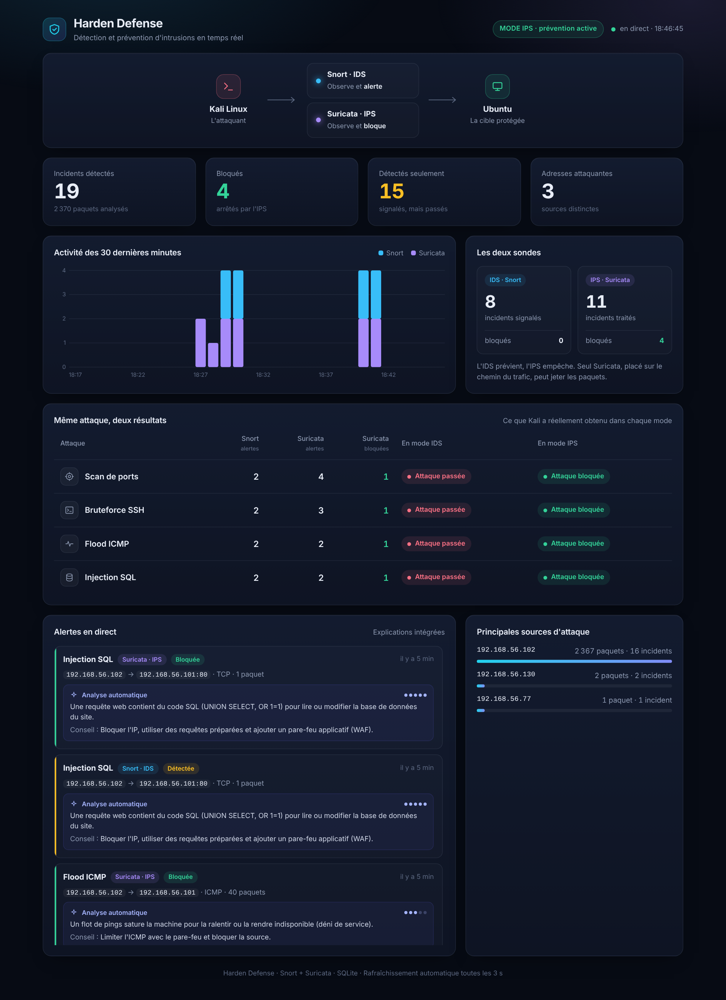
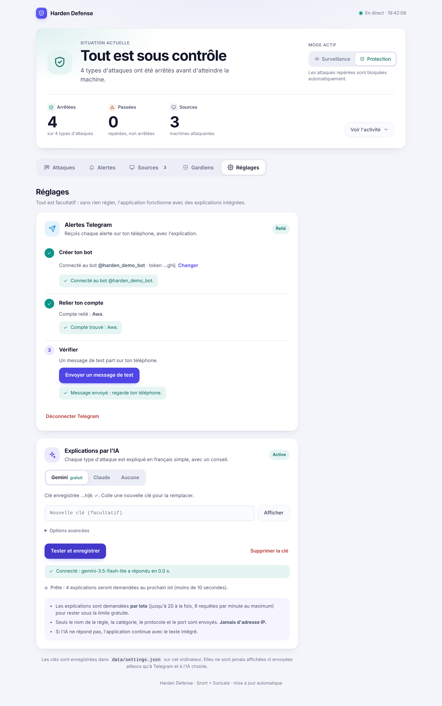

# Harden Defense

**Un mini-SOC de laboratoire** : une machine attaque, une autre se défend, et un tableau de bord montre
en direct **la différence entre un IDS (qui prévient) et un IPS (qui bloque)**.



<sub>Les deux modes, avec des données de démonstration (`python -m harden.demo`). Affichage progressif : on voit d'abord la situation, puis l'utilisateur choisit ce qu'il veut approfondir (Attaques, Alertes, Sources, Gardiens). Sur téléphone, les onglets sont en bas de l'écran.</sub>

```
  Kali Linux (attaquant)  ──►  Ubuntu (défenseur)
                                 ├─ Snort     = IDS : observe et ALERTE
                                 ├─ Suricata  = IPS : observe et BLOQUE
                                 ├─ Collecteur Python ─► base SQLite ─► Dashboard web
                                 ├─ Analyse de chaque alerte par une IA (optionnelle)
                                 └─ Alertes Telegram (optionnelles)
```

| Dossier | Contenu |
|---|---|
| `config/` | Les règles de détection (Snort et Suricata, mêmes attaques) |
| `demarrer.bat`, `setup-windows.ps1` | L'installation Windows en un double-clic (`arreter.bat`, `desinstaller.bat` pour la suite) |
| `install.sh`, `Vagrantfile` | L'installation Ubuntu en une commande, ou `vagrant up` |
| `hors-ligne/` | Fichiers déjà téléchargés (Dropbox, USB) pour ne rien retélécharger |
| `scripts/` | Pilotage du labo (`lab.sh`, `lab-net.sh`, `services.sh`, `install_defender.sh`, `run_app.sh`…) |
| `systemd/` | Les services qui démarrent tout seuls (labo, collecteur, dashboard) |
| `kali/attack.sh` | Les 4 attaques à lancer depuis Kali |
| `harden/` | L'application Python : collecteur, base SQL, IA, Telegram, dashboard |
| `docs/` | `installation.md` + `guide-installation.html/.pdf` + `video/` (installer pas à pas), `ids-vs-ips.md` (le concept), `guide-soutenance.md` (comment tout expliquer) |

## Ce qu'on détecte

| Attaque | Outil Kali | Règle |
|---|---|---|
| Scan de ports | `nmap -sS` | 20 SYN en 5 s depuis la même IP |
| Bruteforce SSH | connexions répétées | 5 connexions au port 22 en 30 s |
| Flood ICMP | `ping` en rafale | 10 pings en 5 s |
| Injection SQL | `curl` avec `UNION SELECT` / `OR 1=1` | contenu de la requête HTTP |

## Installation en une commande

### Windows 10 / 11 (PC Intel ou AMD) : un double-clic

1. Télécharge le projet (**Code → Download ZIP**) et extrais-le.
2. Double-clique sur **`demarrer.bat`** et clique sur **Oui** quand Windows le demande.

Le script installe VirtualBox et Vagrant s'ils manquent, crée une machine Ubuntu qui contient tout le laboratoire (sondes, attaquant intégré, dashboard), puis ouvre <http://localhost:5000>. Il vérifie la virtualisation (BIOS), détecte le conflit Hyper-V/WSL2, se relance en administrateur, et reprend tout seul s'il est interrompu. Ensuite : `demarrer.bat` / `arreter.bat` / `desinstaller.bat`.

**Peu de forfait internet ?** Il ne télécharge que ce qui manque et affiche les tailles avant de commencer (environ **1,2 Go** si rien n'est installé : VirtualBox 178 Mo, Vagrant 248 Mo, image Ubuntu 691 Mo, paquets ~150 Mo). Fichiers déjà reçus par Dropbox ou clé USB : à mettre dans `hors-ligne/` ; VM Ubuntu déjà existante : option légère proposée (~150 Mo). Voir [`hors-ligne/LISEZMOI.md`](hors-ligne/LISEZMOI.md) et `voir-les-telechargements.bat`.

### Ubuntu 22.04 / 24.04 (ordinateur ou VM) : une commande

```bash
git clone https://github.com/atobouh/Harden-defense.git && cd Harden-defense
sudo ./install.sh          # puis http://localhost:5000 → « Lancer la démonstration »
```

Mac Intel : installe VirtualBox + Vagrant puis `vagrant up`. `harden uninstall` (Ubuntu) retire tout. Détails, tailles et erreurs probables dans [docs/installation.md](docs/installation.md).

## Installation à la main (deux machines Ubuntu + Kali)

> **Première fois ?** Trois façons de suivre le pas à pas, au choix (10 minutes pour voir le dashboard, 1 à 2 heures pour le laboratoire complet) : la **vidéo** [docs/video/installation.mp4](docs/video/installation.mp4), le **guide illustré** [docs/guide-installation.html](docs/guide-installation.html) (ou son [PDF](docs/guide-installation.pdf)), ou le texte [docs/installation.md](docs/installation.md).

### 0. Les deux machines (VirtualBox)

Chaque VM doit avoir **deux cartes réseau** :
1. **NAT** (accès internet, pour installer les paquets) ;
2. **Réseau privé hôte** (*Host-only*) : c'est le réseau du labo, Kali et Ubuntu s'y voient, et ton navigateur aussi.

Vérifie avec `ip a` puis `ping` entre les deux VM. Note l'IP d'Ubuntu sur le réseau privé (souvent `192.168.56.x`)
et le nom de sa carte (souvent `enp0s8`).

### 1. Sur Ubuntu (le défenseur)

```bash
git clone https://github.com/atobouh/Harden-defense.git
cd Harden-defense

sudo ./scripts/install_defender.sh enp0s8   # Snort, Suricata, apache2, ssh ; remplace enp0s8 par ta carte du réseau privé
./scripts/install_app.sh                    # dashboard + collecteur (sans sudo)
```

### 2. Démarrer

```bash
sudo ./scripts/lab.sh ids        # 1) mode détection : rien n'est bloqué
./scripts/run_app.sh             # 2) dans un 2e terminal : collecteur + dashboard
```

Ouvre **`http://IP_UBUNTU:5000`** dans le navigateur de ton PC.

### 3. Sur Kali (l'attaquant)

```bash
git clone https://github.com/atobouh/Harden-defense.git && cd Harden-defense/kali
./attack.sh IP_UBUNTU all http://IP_UBUNTU:5000
```

Le script lance le contrôle « trafic normal » puis les 4 attaques, dit pour chacune si elle est **passée** ou
**bloquée**, et envoie le verdict au dashboard.

### 4. La comparaison IDS contre IPS

```bash
sudo ./scripts/lab.sh ips        # sur Ubuntu : Suricata se met à bloquer
```

Relance `./attack.sh …` depuis Kali : les cartes du dashboard **changent de colonne** : de « Repérée, mais passée » vers « Arrêtée ». Chaque carte garde
les deux verdicts (*Surveillance* puis *Protection*). C'est le cœur de la démonstration.

Autres commandes : `sudo ./scripts/lab.sh status` · `sudo ./scripts/lab.sh stop`

## Telegram et IA : la page « Réglages »

Tout est facultatif. Ouvre l'onglet **Réglages** du dashboard : pas de fichier à éditer.



- **Telegram, en 3 étapes guidées** : créer le bot avec @BotFather et coller le token, envoyer `/start` à son bot puis « Trouver mon compte », enfin « Envoyer un message de test ».
- **IA (Gemini gratuit, ou Claude)** : coller la clé et cliquer « Tester et enregistrer ». Une clé qui ne fonctionne pas n'est pas enregistrée, et un message explique quoi corriger.
- Les explications sont demandées **par lots** (jusqu'à 20 alertes dans une seule requête, 8 requêtes par minute au maximum) pour rester sous la limite gratuite. En cas de limite, l'application réessaie toute seule, bascule sur un modèle de secours, puis garde les textes intégrés : elle ne tombe jamais en panne à cause de l'IA.
- Seuls le nom de la règle, la catégorie, le protocole et le port sont envoyés à l'IA : **jamais d'adresse IP**.

**Sécurité des réglages.** Les clés sont enregistrées dans `data/settings.json` (droits 600, ignoré par git) et ne sont jamais renvoyées au navigateur.
Elles ne se modifient que depuis la machine qui fait tourner l'application, ou depuis un autre appareil avec le **code à 6 chiffres affiché dans le terminal** au démarrage.

*Avancé* : les mêmes réglages peuvent venir du fichier `.env` (voir `.env.example`) ; la page Réglages a priorité.

## Voir le dashboard sans lancer les VM

```bash
.venv/bin/python -m harden.demo --reset
.venv/bin/python -m harden.dashboard      # http://localhost:5000
```

## Tests automatiques

```bash
python3 -m unittest discover -s tests -v
```

## Modifier une règle

Édite `config/snort/local.rules` et `config/suricata/local.rules`, puis `sudo ./scripts/install_defender.sh enp0s8`
et `sudo ./scripts/lab.sh ips`.

## Sécurité

- Projet **pédagogique, pour un réseau de laboratoire isolé** : le dashboard n'a pas de mot de passe. Ne l'expose pas sur internet.
- `.env` et `data/settings.json` (token Telegram, clés API) sont ignorés par git : ne les publie jamais.
- N'attaque que **tes propres machines**.

## Problèmes fréquents

| Symptôme | Solution |
|---|---|
| `Suricata : ERREUR` à l'installation | `sudo suricata -T -c /etc/suricata/suricata.yaml -v` affiche la ligne en cause |
| Snort ne génère aucune alerte | Vérifie la carte réseau (`ip a`) et relance `install_defender.sh <carte>`. `lab.sh` lance déjà Snort avec `-k none` (sommes de contrôle ignorées : sinon, sur VM, Snort peut rester muet) |
| Kali ne répond plus après une attaque en mode IPS | Normal : l'IPS l'a bloqué quelques secondes (les compteurs se remettent à zéro) |
| Le dashboard est vide | `sudo ./scripts/lab.sh status`, et lance `./scripts/run_app.sh` |
| « Clé refusée » / « Limite gratuite atteinte » | Voir la page Réglages et [docs/installation.md](docs/installation.md#ça-ne-marche-pas-) |
