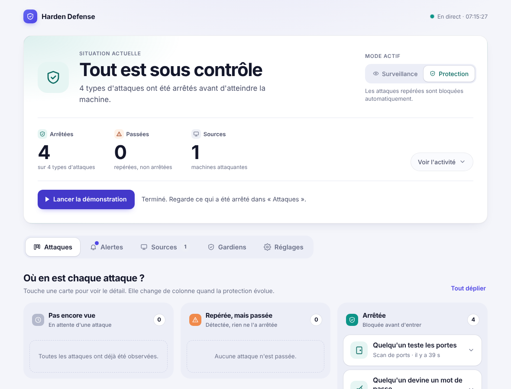

# Installer Harden Defense sur ton ordinateur

> **Trois façons de suivre ce guide, au choix :**
> - la **vidéo** : [`docs/video/installation.mp4`](video/installation.mp4) (7 minutes, sous-titrée en français) ;
> - le **guide illustré** : [`docs/guide-installation.html`](guide-installation.html) (à ouvrir dans le navigateur : commandes à copier en un clic, et tes valeurs à saisir une fois) ou sa version PDF [`docs/guide-installation.pdf`](guide-installation.pdf) ;
> - ce document, ci-dessous.
>
> La vidéo est tournée sur un laboratoire simulé : les commandes sont exactement celles à taper sur tes machines. Les écrans de VirtualBox y sont montrés par des schémas.

## 🪟 Windows 10 / 11 : un double-clic (PC Intel ou AMD)

1. Sur GitHub : bouton vert **Code → Download ZIP**, puis clic droit sur le ZIP → **Extraire tout…**. (Ou `git clone` si tu as git.)
2. Dans le dossier obtenu, **double-clique sur `demarrer.bat`** et clique sur **Oui** quand Windows demande l'autorisation.
   *(Autre façon : clic droit sur `setup-windows.ps1` → « Exécuter avec PowerShell ».)*
3. Une fenêtre affiche l'avancement en français. **25 à 40 minutes la première fois** (surtout du téléchargement). À la fin, le navigateur s'ouvre sur <http://localhost:5000>.
4. Clique sur **« Lancer la démonstration »** (mode Surveillance : tout est repéré, rien n'est bloqué), puis sur **Protection**, attends 10 secondes, relance : les 4 attaques sont **arrêtées**.

| Dashboard en mode Surveillance | Dashboard en mode Protection |
|---|---|
|  |  |

Le script s'occupe de tout : il installe **VirtualBox**, **Vagrant** (et git si besoin) seulement s'ils manquent, vérifie que la virtualisation est active, crée la machine Ubuntu (avec Snort, Suricata, le dashboard et l'attaquant intégré), puis ouvre le dashboard. **Il peut être relancé sans danger** : il reprend où il s'était arrêté et ne retélécharge rien.

**Ensuite** : `demarrer.bat` (allumer + ouvrir le dashboard), `arreter.bat` (éteindre), `desinstaller.bat` (supprimer la machine virtuelle, après confirmation), `voir-les-telechargements.bat` (voir ce qui serait téléchargé, sans rien installer).

### Combien ça télécharge, et comment l'éviter

| Élément | Taille | Si tu l'as déjà |
|---|---|---|
| VirtualBox 7.2 | 178 Mo | détecté, non retéléchargé |
| Vagrant 2.4 | 248 Mo | détecté, non retéléchargé |
| Image Ubuntu 22.04 | 691 Mo | réutilisée si déjà dans Vagrant, ou si le fichier est dans `hors-ligne`, Téléchargements, Bureau, Documents ou Dropbox |
| Paquets Ubuntu (Snort, Suricata, Apache…) | environ 150 Mo *(estimation)* | téléchargés dans la machine, sauf avec la machine exportée |
| **Total si rien n'est installé** | **environ 1,2 Go** | peut tomber à presque rien |

Le script **affiche ces tailles avant de commencer** et ne télécharge que ce qui manque. Pour économiser du forfait :

- **Dropbox / clé USB** : télécharge (ou fais télécharger) les 3 gros fichiers avec une bonne connexion, mets-les dans le dossier `hors-ligne` du projet : le script les installe sans rien télécharger. Liste, liens et noms de fichiers : [`hors-ligne/LISEZMOI.md`](../hors-ligne/LISEZMOI.md).
- **Tu as déjà une VM Ubuntu dans VirtualBox** (celle de ton projet de départ) : le script la détecte et propose d'y installer le laboratoire directement. Il ne reste alors que ~150 Mo (pas de VirtualBox, Vagrant ni image à télécharger). À la main, dans la VM : `sudo apt install -y git`, `git clone https://github.com/atobouh/Harden-defense.git`, `cd Harden-defense`, `sudo ./install.sh`, puis ouvrir le navigateur **de la VM** sur <http://localhost:5000>.
- **Exporter la machine** : sur un PC où tout est installé, `powershell -ExecutionPolicy Bypass -File .\setup-windows.ps1 -Action Exporter` crée `harden-defense.box` (plus d'un Go, tout compris). Sur un autre PC, déposé dans `hors-ligne`, il évite tout téléchargement depuis internet (mais pas le transfert du fichier).

### Les erreurs probables sous Windows

| Message du script | Cause et solution |
|---|---|
| « La virtualisation est désactivée dans le BIOS » | À activer une fois dans le BIOS : redémarre, touche **F2 / Suppr / F10 / F12 / Échap** au démarrage (ou Windows 11 : Paramètres → Système → Récupération → Démarrage avancé → Paramètres du micrologiciel UEFI). Cherche **Intel Virtualization Technology / VT-x** ou **SVM Mode / AMD-V**, mets *Enabled*, **F10**. |
| « Windows fait déjà tourner son propre hyperviseur » / VM très lente ou qui ne démarre pas | **Hyper-V, WSL2 ou « Intégrité de la mémoire »** entrent en conflit avec VirtualBox. Lance `powershell -ExecutionPolicy Bypass -File .\setup-windows.ps1 -DesactiverHyperV`, redémarre, relance. (WSL2/Docker sont alors arrêtés ; retour : `bcdedit /set hypervisorlaunchtype auto`.) |
| « Un redémarrage de Windows est nécessaire » | Normal après VirtualBox / Vagrant (pilotes). Redémarre, puis double-clique à nouveau sur `demarrer.bat` : tout reprend. |
| Téléchargement ou démarrage qui échoue | **Antivirus, pare-feu ou VPN** : mets-les en pause, vérifie ta connexion, relance. Le script réessaie 3 fois et conserve ce qui est déjà téléchargé. |
| L'autorisation Windows est refusée | Il faut un compte **administrateur** pour installer VirtualBox. |
| « winget est introuvable » | Mets à jour *Programme d'installation d'applications* dans le Microsoft Store, ou dépose les fichiers de `hors-ligne` et relance. |
| PC ARM, Windows 32 bits, < 8 Go de RAM, < 15 Go de disque | Le script s'arrête en expliquant pourquoi. |

En cas d'erreur, le script affiche les dernières lignes de son journal ; il est complet dans `%TEMP%\harden-defense-setup.log`.

---

## ⚡ Ubuntu : une commande, rien d'autre à faire

L'attaquant (qui remplace Kali) est créé automatiquement sur la **même machine**, dans un espace réseau isolé. Tout démarre seul à chaque allumage, et tout se pilote depuis le dashboard.

**Tu as Ubuntu 22.04 ou 24.04** (sur ton ordinateur ou dans une VM). Dans un terminal :

```bash
git clone https://github.com/atobouh/Harden-defense.git
cd Harden-defense
sudo ./install.sh
```

10 à 15 minutes, surtout du téléchargement, aucune question posée. Puis ouvre **<http://localhost:5000>** :

1. clique sur **« Lancer la démonstration »** : les 4 attaques partent une par une et le tableau se remplit (mode Surveillance : tout est repéré, rien n'est bloqué) ;
2. clique sur **Protection** (le sélecteur en haut), attends une dizaine de secondes, relance la démonstration : les attaques sont **arrêtées**.

**Mac Intel, ou Windows en ligne de commande** (sous Windows, préfère le double-clic ci-dessus) : installe [VirtualBox](https://www.virtualbox.org/wiki/Downloads) et [Vagrant](https://developer.hashicorp.com/vagrant/install), puis :

```bash
git clone https://github.com/atobouh/Harden-defense.git
cd Harden-defense
vagrant up
```

15 à 20 minutes, puis ouvre <http://localhost:5000> sur ton PC. (`vagrant halt` éteint, `vagrant up` rallume, `vagrant destroy` efface tout.) Les Mac à puce Apple ne font pas tourner VirtualBox.

La commande `harden` (facultative, tout se fait aussi dans la page) : `harden status`, `harden ids`, `harden ips`, `harden demo`, `harden open`, `harden pin`, `harden logs`, `harden uninstall`.

**Ce que ça installe, et ce que ça touche sur ta machine** : Snort, Suricata, Apache, SSH, nmap, Python ; un réseau virtuel interne `10.88.0.0/24` ; deux comptes techniques (`harden`, `harden-attacker`) ; trois services (`harden-lab`, `harden-collector`, `harden-dashboard`). Apache ne répond que sur le réseau interne du labo. En mode Protection, le pare-feu ne filtre que le trafic de ce réseau interne : ton accès à internet n'est pas touché. `harden uninstall` retire tout.

> La suite de ce document (**A** et **B**) sert pour les autres cas : voir seulement le dashboard avec des données de démonstration (A), ou monter le laboratoire à la main avec **deux** machines virtuelles Ubuntu + Kali (B), comme dans la vidéo.

| | **Express** | **A. Voir le dashboard** | **B. Deux VM à la main** |
|---|---|---|---|
| Ce que tu obtiens | Le vrai labo, tout automatique | Le tableau de bord avec des données de démonstration | Le vrai labo, avec un vrai Kali |
| Ce qu'il faut | Ubuntu, ou VirtualBox + Vagrant | Python | VirtualBox + 2 VM (Ubuntu et Kali) |
| Durée | 15 minutes | 10 minutes | 1 à 2 heures |

---

## A. Voir le dashboard (Windows, Mac ou Linux)

**1. Installe Python** (version 3.10 ou plus récente) depuis <https://www.python.org/downloads/>.
Sous Windows, coche **« Add Python to PATH »** pendant l'installation.

**2. Récupère le projet.** Soit avec git : `git clone https://github.com/atobouh/Harden-defense.git`,
soit sur GitHub avec le bouton vert **Code → Download ZIP**, puis décompresse-le.

**3. Ouvre un terminal dans le dossier du projet** (Windows : clic droit dans le dossier → « Ouvrir dans le terminal »), puis :

*Windows (PowerShell)*
```powershell
py -m venv .venv
.venv\Scripts\pip install -r requirements.txt
.venv\Scripts\python -m harden.demo --reset
.venv\Scripts\python -m harden.dashboard
```

*Mac / Linux*
```bash
python3 -m venv .venv
.venv/bin/pip install -r requirements.txt
.venv/bin/python -m harden.demo --reset
.venv/bin/python -m harden.dashboard
```

**4. Ouvre <http://localhost:5000>** dans ton navigateur. Pour arrêter : `Ctrl + C` dans le terminal.

C'est tout. Tu peux déjà aller dans l'onglet **Réglages** pour brancher Telegram et l'IA (voir plus bas).

---

## B. Le vrai laboratoire avec VirtualBox

### Ce qu'il te faut
- Un ordinateur avec **8 Go de mémoire** au minimum (16 Go, c'est confortable) et 40 Go de disque libre.
- [VirtualBox](https://www.virtualbox.org/wiki/Downloads) (gratuit).
- L'image d'**Ubuntu** (22.04 ou 24.04) : <https://ubuntu.com/download/desktop>.
- L'image de **Kali Linux** : <https://www.kali.org/get-kali/> (prends « Virtual Machines », elle est déjà installée).

### Étape 1 : un réseau privé entre les deux machines
Dans VirtualBox : **Fichier → Outils → Gestionnaire de réseau → Réseaux hôtes uniquement → Créer**, et active le **serveur DHCP**.
C'est le câble virtuel entre Kali et Ubuntu (et ton ordinateur y est branché aussi, pour ouvrir le dashboard).

### Étape 2 : régler les deux machines
Pour **chaque** machine (Ubuntu et Kali) : **Configuration → Réseau**
- **Carte 1** : *NAT* (pour avoir internet et installer les programmes).
- **Carte 2** : *Réseau privé hôte* (le réseau que tu viens de créer).

Ubuntu : 4 Go de mémoire, 2 processeurs. Kali : 2 Go, 2 processeurs.

### Étape 3 : installer sur Ubuntu (le défenseur)
Démarre Ubuntu, ouvre un terminal, puis :
```bash
ip a                                   # note le nom de la 2e carte (souvent enp0s8) et son IP (192.168.56.xxx)
sudo apt update && sudo apt install -y git
git clone https://github.com/atobouh/Harden-defense.git
cd Harden-defense
sudo ./scripts/install_defender.sh enp0s8      # remplace enp0s8 par le nom de TA 2e carte
./scripts/install_app.sh
```
L'installation dure quelques minutes. À la fin, les deux lignes `Suricata : OK` et `Snort : OK` doivent apparaître.

### Étape 4 : démarrer le laboratoire
Dans le terminal d'Ubuntu :
```bash
sudo ./scripts/lab.sh ids          # mode Surveillance : on observe, on ne bloque rien
```
Dans un **deuxième** terminal d'Ubuntu :
```bash
cd Harden-defense && ./scripts/run_app.sh
```
Le terminal affiche l'adresse du dashboard et un **code à 6 chiffres** (utile pour les réglages à distance).
Depuis **ton ordinateur**, ouvre `http://192.168.56.xxx:5000` (l'IP d'Ubuntu).

### Étape 5 : attaquer depuis Kali
Démarre Kali, ouvre un terminal :
```bash
git clone https://github.com/atobouh/Harden-defense.git && cd Harden-defense/kali
./attack.sh 192.168.56.xxx all http://192.168.56.xxx:5000
```
(Remplace `192.168.56.xxx` par l'IP d'Ubuntu.) Regarde le dashboard : les attaques sont **passées** mais repérées.

### Étape 6 : passer en mode Protection
Sur Ubuntu : `sudo ./scripts/lab.sh ips`, puis relance `./attack.sh …` depuis Kali.
Les cartes du dashboard glissent de « Repérée, mais passée » vers « **Arrêtée** ». C'est la démonstration.

---

## Brancher Telegram et l'IA (dans la page Réglages)

Ouvre l'onglet **Réglages** du dashboard. Rien n'est obligatoire.

**Telegram (3 étapes guidées)**
1. Dans Telegram, ouvre **@BotFather**, envoie `/newbot`, réponds aux deux questions. Il te donne un *token* : colle-le dans la page, clique **Connecter**.
2. Ouvre ton bot dans Telegram, envoie-lui `/start`, puis clique **Trouver mon compte**.
3. Clique **Envoyer un message de test** : il arrive sur ton téléphone.

**L'IA (gratuite avec Gemini)**
1. Va sur <https://aistudio.google.com/apikey>, connecte-toi avec ton compte Google, crée une clé.
2. Colle-la dans la page, choisis **Gemini**, clique **Tester et enregistrer**. Si la clé fonctionne, elle est enregistrée ; sinon, un message t'explique quoi corriger.

Les explications sont demandées par lots pour rester sous la limite gratuite de Google (15 requêtes par minute) ; si la limite est atteinte,
l'application réessaie toute seule et garde les textes intégrés en attendant.

> **Réglages depuis un autre appareil.** Depuis l'ordinateur où tourne l'application, aucun code n'est demandé. Depuis un autre appareil
> (ton PC quand l'application tourne dans la VM Ubuntu), la page te demande le **code à 6 chiffres** affiché dans le terminal.
> Sans ce code, personne d'autre sur le réseau ne peut modifier tes clés.

---

## Ça ne marche pas ?

| Symptôme | Que faire |
|---|---|
| `python` introuvable sous Windows | Réinstalle Python en cochant « Add Python to PATH », ou utilise `py` à la place de `python`. |
| Le dashboard est vide (mode B) | Vérifie `sudo ./scripts/lab.sh status` et que `run_app.sh` tourne. Lance une attaque depuis Kali. |
| Le script d'attaque dit « Le scan n'a pas pu s'exécuter » | Installe nmap (`sudo apt install nmap`). Sans `sudo` sans mot de passe, Kali utilise un scan par connexion : c'est normal. |
| Kali n'atteint pas Ubuntu | `ping 192.168.56.xxx` depuis Kali. Vérifie que les deux machines ont la carte 2 en *Réseau privé hôte*. |
| L'ordinateur n'atteint pas le dashboard | Utilise l'IP de la 2e carte d'Ubuntu (`ip a`), pas celle du NAT (10.0.2.x). |
| « Clé refusée » | Recopie la clé en entier, sans espace. Crée-en une nouvelle dans AI Studio si besoin. |
| « Limite gratuite atteinte » | Attends une minute : l'application réessaie seule. Elle utilise un modèle de secours entre-temps. |
| Telegram : « Rien reçu pour l'instant » | Ouvre ton bot dans Telegram, envoie-lui `/start`, puis reclique sur **Trouver mon compte**. |
| Express : le dashboard ne s'ouvre pas | `harden status` puis `harden logs`. Redémarre : `sudo harden restart`. |
| Express : « Les sondes ne tournent pas » | Attends 15 secondes après le démarrage de l'ordinateur, ou clique sur Surveillance. |
| Express : les boutons sont grisés ou refusent | Ouvre la page depuis la machine elle-même (`http://localhost:5000`). Depuis un autre appareil, entre le code (`sudo harden pin`) dans Réglages. |
| Suricata affiche `ERREUR` à l'installation | `sudo suricata -T -c /etc/suricata/suricata.yaml -v` montre la ligne en cause. |

**Mettre à jour le projet** : `git pull` dans le dossier, puis relance `./scripts/run_app.sh`.

**N'attaque que tes propres machines virtuelles.**
